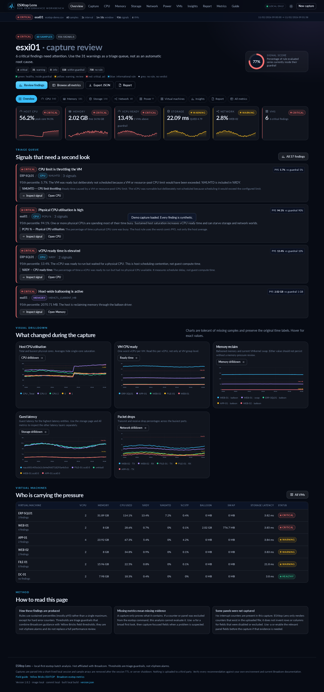
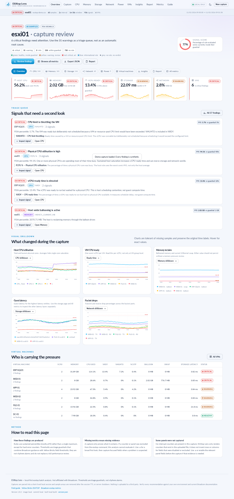

# ESXtop Lens

[](https://github.com/RogerBergling/esxtop-perf/actions/workflows/ci.yml)
[](https://github.com/RogerBergling/esxtop-perf/actions/workflows/docker-publish.yml)

**Turn a raw ESXi `esxtop` batch capture into a drillable performance diagnosis.**

ESXtop Lens imports the PDH-CSV (or gzip) produced by `esxtop -b`, parses every counter, draws SVG time-series charts, applies transparent threshold rules, and explains what to check next with links to Broadcom and Yellow Bricks. It is a local-first troubleshooting workbench, not a monitoring platform.

## The easy way to get it running

**What you need:** Docker with Docker Compose. You do **not** need Python, Node, a database, a build step, or a clone of this repository.

### 1. Get the Compose file

```bash
curl -O https://raw.githubusercontent.com/RogerBergling/esxtop-perf/main/compose.yaml
```

### 2. Start it

```bash
docker compose up -d
```

Docker pulls the prebuilt image from GHCR. If the package is still private, authenticate once with a token that has `read:packages`:

```bash
echo "$CR_PAT" | docker login ghcr.io -u YOUR_GITHUB_USERNAME --password-stdin
```

Then run `docker compose up -d` again.

### 3. Open it and try it

Open **http://localhost:8004** in your browser.

- Click **Load demo capture** to explore the app immediately with synthetic data.
- Or drag a real `.csv` / `.csv.gz` esxtop capture onto the import page.
- Nothing is uploaded to a third party. The capture is processed by the local server and kept in a short-lived local session.

Need a capture from an ESXi host? Run this on the host, then download the file:

```bash
esxtop -b -a -d 2 -n 100 | gzip -9c > /vmfs/volumes/datastore1/perf.csv
```

> **Local by default:** Compose publishes the app on `127.0.0.1` only. Before exposing it on a LAN or the internet, set `ESXTOP_UPLOAD_PASSWORD` and use HTTPS/reverse-proxy authentication. See [Upload password and public exposure](#upload-password-and-public-exposure).

To stop it:

```bash
docker compose down
```

To update it deliberately:

```bash
docker compose pull
docker compose up -d --force-recreate
```

That is the whole first-run path. The rest of this README is the detailed reference: local Python setup, security, capture internals, sizing, API, architecture and validation.

## Screenshots

| Dark control room | Light theme |
| --- | --- |
|  |  |

Both screenshots use the bundled synthetic demo capture. The demo contains intentional CPU, memory, NUMA, storage and network pressure so every state can be inspected without a real ESXi host.

## What it does

- **Imports real esxtop output** — PDH-CSV 4.0, gzip, case-insensitive counter names, human-readable labels (`% Ready`) and short abbreviations (`%RDY`).
- **Drills into every metric** — search all columns, chart any series, inspect all samples, and export raw series to CSV.
- **All esxtop panels** — host cores, Group Cpu, Vcpu, Group Memory, Virtual Disk, Disk Device/Adapter/Path/Partition/SCSI Device, Network Port, Power, Interrupt Cookie, NUMA and vSAN-enabled captures. Every captured field is catalogued or preserved as a raw field.
- **Green / yellow / red** — a transparent rule engine with sustained percentile checks, not a single-spike alarm.
- **Evidence and references** — every finding shows the observed value, guardrail, why it matters, a next action and Broadcom/Yellow Bricks sources.
- **HTML and PDF reports** — a standalone HTML report and browser print-to-PDF with the executive summary, a prioritized “What to do next” action plan, every finding, and a technical reference covering KAVG, DAVG, GAVG, %RDY, %MLMTD, %CSTP and the other counters behind the findings. Choose multiple hosts and VMs, filter seven metric categories, and export HTML, PDF or a category-filtered metrics CSV.
- **Written field guide** — the capture command explained token by token, CSV anatomy, counter semantics, playbooks and caveats.
- **Focused capture manual** — a step-by-step `-c` workflow with a command builder, verification recipe and the traps that make a configuration silently ineffective.
- **Local-only processing** — captures are parsed into a short-lived local session. No analytics, no third-party upload; the session is removed after 30 minutes or on restart. An optional upload password can be set before exposing the app beyond localhost.
- **Docker + GHCR** — multi-arch image publishing; updates are deliberate (`docker compose pull`), with no Docker socket mounted and no automatic-update sidecar.

## Detailed setup

Use this section for local Python, custom builds, LAN access, troubleshooting, or the full first-run/update behavior. Capture files are often gzip data even when named `.csv`; ESXtop Lens detects gzip from the magic bytes, so both plain CSV and gzip work under any filename.

### Docker

```bash
curl -O https://raw.githubusercontent.com/RogerBergling/esxtop-perf/main/compose.yaml
docker compose up -d
```

Open **http://localhost:8004** and drop in a capture, or click **Load demo capture**. The Compose port is bound to **127.0.0.1** by default. To expose it on the LAN, set `ESXTOP_UPLOAD_PASSWORD` in `.env`, change the Compose port mapping to `8004:8080`, and use HTTPS/reverse-proxy authentication; see [Upload password and public exposure](#upload-password-and-public-exposure).

If GHCR returns an authentication error, the package is still private. Authenticate with a token that has `read:packages`:

```bash
echo "$CR_PAT" | docker login ghcr.io -u YOUR_GITHUB_USERNAME --password-stdin
```

or make the package public once under **Packages → esxtop-perf → Package settings → Change visibility → Public**.

Update manually:

```bash
docker compose pull
docker compose up -d --force-recreate
curl -s http://localhost:8004/version.json | python3 -m json.tool
```

The Compose file does **not** mount `/var/run/docker.sock` and does **not** include an automatic-update sidecar. Update deliberately with the commands above. If you use an external updater, secure it separately; ESXtop Lens does not ship one.

### Local Python

Requirement: **Python 3.10+**. No `pip install` is needed.

```bash
./start.sh
# or
python3 start.py
# no browser
python3 start.py --no-browser
# fixed host/port
python3 start.py --host 0.0.0.0 --port 8080 --no-browser
```

On Windows, double-click `start.bat`, or run `py -3 start.py`.

The launcher serves the app on the first free port in **8080–8099** unless `--port` is supplied. Open the site through the server, not as a `file://` URL.

### Upload password and public exposure

The upload endpoint is **not remote code execution**: uploaded bytes are written to a temporary file, parsed as CSV or gzip data, and never executed, imported or passed to a shell. The parser has no `eval`, `exec`, `pickle`, template execution or shell command based on file content.

An unauthenticated public deployment is still a real availability and data-handling risk:

- a large all-fields capture can consume several seconds of CPU and well over 1 GB of memory;
- repeated or concurrent uploads can exhaust a small container;
- the upload endpoint has no built-in rate limit;
- captures can contain sensitive host, VM, datastore and device names;
- `/api/series` uses a random session ID as a bearer capability; the demo endpoint is intentionally public.

For local or trusted-LAN use, no password is needed. Before exposing the app to the internet, generate a strong random value and set it in the server environment:

```bash
export ESXTOP_UPLOAD_PASSWORD="$(python3 -c 'import secrets; print(secrets.token_urlsafe(32))')"
python3 start.py --host 0.0.0.0 --port 8080 --no-browser
```

Or put it in `.env` next to `compose.yaml`:

```text
ESXTOP_UPLOAD_PASSWORD=use-a-long-random-value-here
```

Then:

```bash
docker compose up -d --force-recreate
```

When the variable is set:

- `POST /api/analyze` returns **401** unless the request carries `X-ESXTOP-Upload-Password`;
- the import page shows an upload-password field;
- the browser first verifies the password against `GET /api/upload-auth` before sending a file, so a wrong password produces a clear message instead of a network error while a large body is in flight;
- the value is kept in `sessionStorage` for that tab, not `localStorage`;
- the server compares it with `hmac.compare_digest` and never includes it in `/api/health` or server-rendered HTML (the browser fills the password field from `sessionStorage`);
- an incorrect password produces the same generic error as a missing password.

**Do not hardcode a password in the frontend.** A password in HTML or JavaScript is visible to every visitor and is not a security control. The password travels in an HTTP header, so use HTTPS whenever the app is reachable outside localhost; without TLS the password can be observed on the network. The environment-variable gate is deliberately server-side. For a public or multi-user deployment, put the whole app behind HTTPS and reverse-proxy authentication (Basic Auth, OIDC or an identity-aware proxy), not just the upload route. Configure the proxy to redact `X-ESXTOP-Upload-Password` from access logs and to enforce body-size/read timeouts. Keep the container read-only, keep the `/tmp` tmpfs and memory limits, lower `ESXTOP_MAX_UPLOAD_MB`, and add per-IP rate limiting at the proxy.

The upload password protects **file upload**, not the entire application. The bundled demo, static assets, health endpoint and session-based chart API remain reachable. If that is not acceptable, use reverse-proxy authentication for the whole site.

If the import page reports “Could not reach the analysis server”, verify that the container/server is running, the URL and port are reachable from the browser, and any reverse proxy forwards `X-ESXTOP-Upload-Password`, permits the upload body size, and has a read timeout longer than the upload. If it reports “upload password was rejected”, re-check the exact value in `ESXTOP_UPLOAD_PASSWORD` and the password typed into the page.

A quick password/proxy check from the machine running the browser:

```bash
curl -i -H "X-ESXTOP-Upload-Password: YOUR_PASSWORD" \
  http://localhost:8004/api/upload-auth
```

`200` means the password and proxy header path work. `401` means the password is wrong or the proxy strips the header. A connection error means the server/port is not reachable.

### Build the image

```bash
docker build \
  --build-arg APP_VERSION=1.8.2 \
  --build-arg IMAGE_TAG=local \
  --build-arg GIT_SHA="$(git rev-parse --short HEAD)" \
  --build-arg BUILD_DATE="$(date -u +%Y-%m-%dT%H:%M:%SZ)" \
  -t esxtop-lens .
docker run --rm -p 8080:8080 --read-only --tmpfs /tmp:rw,noexec,nosuid,size=2g -m 2g esxtop-lens
```

When the container is reachable beyond localhost, add `-e ESXTOP_UPLOAD_PASSWORD='...'` and use HTTPS at the proxy.

## Build system and dependencies

There is no bundler, framework, CDN, external font or runtime dependency.

| Layer | Technology | Why |
| --- | --- | --- |
| HTTP/API | Python 3 standard library (`http.server`, `csv`, `gzip`, `json`, `sqlite3`) | Portable, auditable, no supply-chain surface |
| Parser/analysis | Python 3 standard library | Streaming file handling, deterministic rules, easy unit tests |
| Series store | Temporary SQLite in `/tmp` | Lazy-load chart data without keeping the whole JSON response in browser memory |
| Frontend | Native ES modules, HTML, CSS | No build step, no dependency drift |
| Charts | Hand-written SVG + pointer events | No charting library, responsive and accessible |
| Container | `python:3.12-alpine`, non-root, read-only | Small attack surface |
| Delivery | GitHub Actions → GHCR, Compose | Multi-arch image publishing without Docker socket exposure |

Node is not required to run the app. It is used only in CI for `node --check`.

## Architecture

```text
Browser
  └─ File picker / drag-drop / Load demo
       │  XMLHttpRequest POST (raw bytes, filename in query)
       ▼
Python server
  ├─ sniff gzip magic, stream-decompress with limits
  ├─ parse PDH-CSV header and rows
  ├─ normalise counter names and entity instances
  ├─ compute per-series statistics (avg, min, p05, p50, p95, max, first, last)
  ├─ apply threshold rules and group duplicate host CPU signals
  ├─ pack sample arrays into a short-lived SQLite session
  └─ return metadata, stats and findings only, gzip-compressed over HTTP
       ▼
Vanilla ES-module SPA
  ├─ hash router and capture state in memory
  ├─ KPI cards, findings, tables, metric explorer
  ├─ fetch only the visible series from /api/series
  └─ custom SVG line charts with hover, legend toggles and thresholds
```

### Project structure

```text
esxtop-perf/
├── esxtop_perf/
│   ├── catalog.py          Metric aliases, units, descriptions, KB references
│   ├── config.py           Environment-driven limits and session settings
│   ├── parser.py           PDH-CSV/gzip streaming parser and statistics
│   ├── analysis.py         Threshold rules, findings, score, category summary
│   ├── sessions.py         Temporary SQLite series store for lazy chart loading
│   └── server.py           Static server, upload/session APIs, healthcheck
├── public/
│   ├── index.html          App shell
│   ├── version.json        Local fallback; overwritten by Docker build
│   ├── assets/
│   │   ├── css/app.css     Design system, responsive and print styles
│   │   └── js/
│   │       ├── app.js      Hash router, theme, upload lifecycle
│   │       ├── theme-init.js Pre-paint local theme
│   │       ├── pages.js    Overview, category pages, VM, insights, explorer, report view
│   │       ├── report.js   Standalone HTML report and print-to-PDF export
│   │       ├── technical.js Shared KAVG/DAVG/GAVG/%RDY and counter relationships
│   │       ├── charts.js   SVG line chart, tooltip, legend, sparklines
│   │       ├── components.js UI helpers and formatting
│   │       └── markdown.js Dependency-free Markdown renderer
│   ├── demo/               Deterministic synthetic capture for the demo
│   └── docs/               Deep esxtop field guide (Markdown, served and rendered)
├── scripts/
│   ├── make_demo.py        Regenerate the demo capture
│   ├── verify.py           Repo, packaging, docs and module-integrity checks
│   └── smoke.py            Starts the real server and tests HTTP/API
├── tests/test_esxtop.py    Parser, normalisation, gzip, findings, grouping
├── docs/screenshots/        README screenshots from the running app
├── start.py                Python entry point
├── start.sh / start.bat    Linux/macOS and Windows launchers
├── Dockerfile
├── compose.yaml
└── .github/workflows/
    ├── ci.yml
    └── docker-publish.yml
```

## The esxtop command explained

The app has a full field guide at **Field guide** in the UI, and the same Markdown is in [`public/docs/esxtop-field-guide.md`](public/docs/esxtop-field-guide.md).

Short version of the supplied command:

| Token | Meaning |
| --- | --- |
| `esxtop` | ESXi performance utility; needs a privileged shell. |
| `-b` | Batch mode: no interactive screen, write PDH-CSV to stdout. The entity set is locked at the first snapshot. |
| `-a` | Collect all fields, ignoring the saved field layout. Widest capture. |
| `-d 2` | Two seconds between samples. |
| `-n 100` | Roughly 100 samples. Nominal coverage is `n × d`; timestamps in the file are authoritative. |
| `gzip -9c` | Compress stdout at maximum gzip level. The output is binary, not plain text CSV. |
| `>` | Shell redirect to a datastore path. Ensure free space and do not target the datastore under investigation. |

For a real incident, use a unique file name:

```text
esxtop -b -a -d 2 -n 300 \
  | gzip -9c > /vmfs/volumes/SAS.-LOCAL/esxtop-$(hostname)-$(date +%FT%H%M).csv.gz
```

### Focused capture with `-c`

When an all-metric capture is too large, prepare a repeatable field layout interactively:

1. Run `esxtop` on the ESXi host.
2. Switch to the panel: `u` Disk Device, `d` Disk Adapter, `v` VM Disk, `c` CPU, `m` memory, `n` network.
3. Press `f` to enable/disable fields and `o` to reorder if needed.
4. Repeat for every panel you want to include or exclude; the configuration file stores all panel layouts. A single rc can contain `d`, `u` and `v` together, but clear the fields in the panels you do not want.
5. Press uppercase **`W`**. At the prompt, enter an absolute datastore path such as `/vmfs/volumes/datastore1/esxtop-disk.rc`.
6. Validate with a short `-n 2` test, then run the real capture.

```text
esxtop -b -c /vmfs/volumes/datastore1/esxtop-disk.rc -d 5 -n 60 \
  > /vmfs/volumes/datastore1/esxtop_disk.csv
```

**Do not add `-a`** to a focused command — Broadcom documents that `-a` overrides the configuration and collects all statistics. `-c` takes an absolute path; `.esxtoprc` is not a guaranteed default name. The exact default varies by ESXi release and is shown in the `W` prompt. Do not keep the only copy under `/tmp` or on an unhealthy datastore.

**One rc, several storage panels.** `d` (Disk Adapter), `u` (Disk Device) and `v` (VM Disk) can all coexist in one rc file; configure each panel in the same interactive session and press `W` once. There is no separate Datastore panel in esxtop: a datastore can span devices/extents, so use `u` for the backing device and `v` for per-VM I/O, or use the vSphere Datastore chart. The file stores every panel layout, so clear fields in the other panels if you want a storage-only capture. The number of panel-layout lines is release-specific; the last line holds options. See the [field guide](public/docs/esxtop-field-guide.md#focused-capture-with--c) for a real ESXi 8.0 U3 `.esxtop60rc` annotated line by line.

The other panels are part of the rc file even when you only care about storage. Clear their fields before `W`, or they will remain in the batch header:

| Key | Panel | What it contains | Storage-only action |
|---|---|---|---|
| `c` | CPU | Host PCPU and world/group scheduling: `%USED`, `%RUN`, `%RDY`, `%MLMTD`, `%CSTP`, `%SWPWT`. | Clear all, or retain CPU contention fields if the incident is mixed. |
| `m` | Memory | Host free/overcommit, ballooning, VMkernel swap, compression and NUMA locality. | Clear all unless memory pressure is part of the same investigation. |
| `n` | Network | Ports, uplinks, packet/bit rates, link state and drop percentages. | Clear all; retain drops and throughput for iSCSI/NFS storage paths. |
| `i` | Interrupts | Per-CPU interrupt activity and vector data. | Clear all unless investigating a driver, NIC or HBA interrupt storm. |
| `p` | CPU Power | Power state, CPU frequency, `%A/MPERF` and power data. | Clear all for normal storage captures. |

### Report scope

The **Report** page is a report builder, not an auto-generated document:

- **All capture** — every host and every VM in the capture.
- **Hosts + VMs** — select one or more ESXi hosts and one or more VMs across those hosts using Ctrl/Cmd-click. If no VM is selected, all VMs on the selected hosts are included.
- **Hosts only** — selected host snapshots, host disk cards and host-level detail; no VM detail sections.
- **Selected VMs only** — only the selected VMs, which may come from any host; host snapshots are omitted.

Seven possible metric-category checkboxes — **CPU**, **Memory**, **Storage**, **Network**, **Power**, **Interrupts** and **Other**; only categories present in the capture are listed. They filter the report capture-wide: summary counts and signal score, findings, the “What to do next” actions, technical reference, categories, VM detail columns and cards, host detail rows and disk cards, the complete appendix, and the filtered metrics CSV. Host/VM selection controls only the detailed host and VM sections. In the appendix every included series is grouped by entity, so each VM appears once as a heading with all of its captured metrics underneath; no series in the selected categories is dropped.

Multi-host captures are detected from the host names in the PDH-CSV counter paths. Press **Generate report** after choosing the scope; HTML, PDF and CSV export buttons remain disabled until the visible report has been generated. The scoped detail includes host snapshots, host storage cards, VM summaries, per-virtual-disk storage latency/I/O, and VM memory/network cards. Only metrics present in the capture are rendered; a disabled field is omitted rather than shown as a dash. HTML and PDF use the chosen host/VM scope and categories; the filtered metrics CSV uses the selected categories.

The app includes a step-by-step **Capture** page and command builder at `#/capture`. A detailed version is also in the [field guide](public/docs/esxtop-field-guide.md#focused-capture-with--c).

Read the [field guide](public/docs/esxtop-field-guide.md) for the world/group model, every important CPU/memory/storage/network counter, the GAVG = DAVG + KAVG rule, practical threshold rationale and troubleshooting playbooks.

### Field coverage and presence-aware views

The parser does not require a fixed field list. Every non-empty PDH-CSV column becomes a series, and the catalogue supplies a stable ID, name, unit and category where the field is known. Unknown vendor fields are preserved with a `RAW:<family>:<counter>` ID instead of being dropped.

A reference all-fields capture (`esxtop -b -a`) was used to validate this release. It contained **145,663 metric columns**, **10 samples**, **17 VMs** and 223 distinct metric IDs across CPU, memory, storage, network, power and interrupt panels. All 223 resolved to catalogued definitions; none remained an unclassified raw field. On the validation host, the server parsed and analysed that capture in about **5.5 seconds**, the browser reached the overview in about **14.5 seconds**, and generating the complete all-category report took about **42 seconds** because it rendered all **145,663 appendix rows**. Category and host/VM scopes reduce that cost substantially. The audit also caught and fixed several real mapping problems:

- CPU and memory `Alloc Min`/`Alloc Max`/`Alloc Shares` fields now resolve by panel instead of sharing one ambiguous ID.
- `PShare Common MBytes` and `PShare Shared MBytes` are separate metrics; they are not merged.
- `QAVG/rd` and `QAVG/wr` are catalogued rather than left as raw storage fields.
- Virtual Disk `Average MilliSec/Read` and `Average MilliSec/Write` map to `LAT/rd` and `LAT/wr`; `Link Speed (Mb/s)` maps to `SPEED` with Mbps units.
- Interrupt Cookie fields have a dedicated **Interrupts** category; the reference capture contains 77,018 interrupt series (per-cookie and per-CPU variants).
- Newer VAAI/UNMAP fields (`ExtStats`, `ResSpace`, `LClone`, ATS/clone/zero latencies, unmap counters) are catalogued with their counter-name units. Where public documentation is ambiguous, the value is kept raw and the description says so rather than inventing a unit.

**Presence rule:** a field is shown only if the uploaded capture contains that column. Zero is a valid value and is retained and displayed. A field that is absent from the capture is omitted from KPI cards, tables, cards, charts, category filters and report sections. A field that is present in the capture can still show `—` for a particular entity or sample when that entity did not emit a value; that is an entity-level absence, not a fabricated field. This is why a focused capture can look much smaller than an `-a` capture and why the report scope checkboxes only list categories that are actually present.

**vSAN caveat:** the reference capture reports `VSAN\Enabled? = 0`, so vSAN-specific counters are not present. vSAN fields are emitted only when vSAN is enabled on the host and the vSAN panel is included. The app documents this in the capture observations and in the field guide; it does not fabricate vSAN metrics.

## Analysis model

Rules are defined in `esxtop_perf/analysis.py` and documented in the field guide. Each finding contains:

- severity (`critical`, `warning`, `info`) and category;
- entity, metric, observed percentile and guardrail;
- affected series and the worst series to inspect;
- a recommendation and source references.

The engine uses P95 for sustained conditions, P05 for “lower is worse” metrics such as NUMA locality, and the maximum for hard error counters such as aborts and failed ATS/UNMAP. Equivalent host CPU counters (`PCPU %`, `% Util Time`, `% Core Util Time`) are grouped into one finding to avoid duplicate noise.

The **signal score** is the percentage of rule-evaluated series currently inside their guardrail. It is a triage aid, not a capacity-planning metric and not a vSphere alarm score.

### Status semantics: Healthy, Warning, Critical, Info and No rule

The status attached to a series or finding is a statement about the **curated rule engine**, not a general statement that the host or VM is healthy. The app deliberately shows the raw value and its context even when no verdict is available.

| Status | What it means | What it does not mean |
| --- | --- | --- |
| **Healthy** (`ok`) | A curated rule evaluated this series at its configured statistic (usually P95, sometimes P05 or maximum) and the value was inside the rule's guardrail. | It does not prove the host, VM, array or application is healthy. Other metrics may be unruled, outside their guardrails, or absent from the capture. |
| **Warning** (`warn`) | The rule was evaluated and crossed its warning threshold. This is a triage prompt to inspect evidence. | It is not automatically a root cause or an outage. A warning can be transient or expected for the workload. |
| **Critical** (`critical`) | The rule was evaluated and crossed its critical threshold, or a hard-error rule found an abnormal value. | It is not proof of the root cause. Confirm the raw series and the surrounding metrics before changing production. |
| **Info** (`info`) | An informational rule matched. This is a contextual signal, commonly used where a value is meaningful but not automatically a warning or critical condition. | It is not a clean pass and not necessarily an incident. It is excluded from the Healthy/Warning/Critical score calculation. |
| **No rule** (`neutral`) | The series was captured and displayed, but no curated threshold applies to it, or the available rules do not target its scope/group. | It does not mean zero, missing, ignored, hidden, broken or healthy. The value still appears in the metric explorer, tables, report appendix and CSV. |

Rules evaluate a specific statistic:

- **P95** for most “higher is worse” conditions, which reduces single-spike noise.
- **P05** for “lower is worse” conditions such as NUMA locality.
- **Maximum** for hard error counters such as aborts, resets and failed ATS/UNMAP operations.
- A small number of rules use another statistic such as average or median where the rule definition says so.

The **signal score** is:

```text
healthy rule-evaluated series / (healthy + warning + critical rule-evaluated series)
```

“Info” and “No rule” are excluded. If no series is rule-evaluated, the score is shown as `—` rather than as 0% or 100%.

**We do not hide captured data.** Every captured series remains available in **All metrics**, its metric page, the complete report appendix and the filtered metrics CSV, including every “No rule” series. A field that is completely absent from the upload is omitted from the UI because there is no captured value to display; it is not converted to zero, healthy or “No rule.” A field that exists but has no value for one entity may show `—` for that entity, which is an entity-level absence rather than a missing captured field.

The absence of a finding is not a guarantee of health. A clean rule result means only that the curated rules evaluated the available series and found no threshold breach. Confirm the raw counters, the guest, the array, the network and the change history before concluding that the environment is healthy.

> Performance is contextual. A red signal is not automatically the root cause, and a clean report is not proof that the host is healthy. Confirm every recommendation in your own guest, array and network.

## Reports

Open **Report** from the overview or the `#/report` route. **Export HTML** downloads a standalone, self-contained report. **Export PDF** opens the browser print dialog; choose **Save as PDF** and keep A4.

The report contains the executive summary, a prioritized **What to do next** action plan derived from the findings, the findings themselves, a **Host snapshot** with CPU, memory, host disk-latency and network stats, **Host disk adapter/device cards** with all captured latency, queue, throughput and error values, a **VM summary**, **VM storage detail** with per-virtual-disk IOPS/throughput/GAVG/DAVG/KAVG/QAVG/QUED/ACTV/aborts/resets, **VM memory and network cards**, a **Technical reference** that explains the counters behind them — including KAVG, DAVG, GAVG, QAVG, `%RDY`, `%MLMTD`, `%CSTP`, ballooning, swap, NUMA locality and storage queue behaviour — and a **complete metric appendix** containing every captured series with Min/Avg/P95/Max/Last/status. The report toolbar also exports the metrics in the selected categories as CSV. The complete appendix groups series by entity, so each VM, host or disk appears once as a heading with every captured metric beneath it. The same technical notes appear on metric pages, finding cards, category pages and VM drilldowns.

## Input and session limits

The current all-metric defaults admit captures up to 200,000 metric columns:

| Limit | Default | Environment variable |
| --- | --- | --- |
| Upload | 512 MB | `ESXTOP_MAX_UPLOAD_MB` |
| Decompressed stream | 1.5 GB | `ESXTOP_MAX_DECOMPRESSED_MB` |
| Total data cells | 20,000,000 | `ESXTOP_MAX_CELLS` |
| Metric columns | 200,000 | `ESXTOP_MAX_SERIES` |
| Samples | 50,000 | `ESXTOP_MAX_ROWS` |
| Session TTL | 30 minutes | `ESXTOP_SESSION_TTL_MINUTES` |
| Concurrent sessions | 4 | `ESXTOP_MAX_SESSIONS` |
| Concurrent upload analyses | 1 | `ESXTOP_MAX_CONCURRENT_ANALYSES` |
| Concurrent HTTP requests | 32 | `ESXTOP_MAX_CONCURRENT_REQUESTS` |
| Request read timeout | 120 seconds | `ESXTOP_REQUEST_TIMEOUT_SECONDS` |
| Series per value request | 200 | `ESXTOP_MAX_REQUEST_SERIES` |
| Cells per value request | 5,000,000 | `ESXTOP_MAX_REQUEST_CELLS` |
| Upload password | unset (no gate) | `ESXTOP_UPLOAD_PASSWORD` |

When `ESXTOP_UPLOAD_PASSWORD` is set, `POST /api/analyze` requires the matching `X-ESXTOP-Upload-Password` header. The browser import page prompts for it and keeps it in `sessionStorage` for the tab. The password is compared server-side with a constant-time comparison and is never embedded in the frontend bundle.

Only `ESXTOP_MAX_CONCURRENT_ANALYSES` uploads are parsed at once (default **1**). A second upload receives **429** rather than competing for memory with a large analysis. Raise this only when the container has enough RAM and `/tmp` for multiple simultaneous captures.

The HTTP server is also bounded by `ESXTOP_MAX_CONCURRENT_REQUESTS` and a read timeout of `ESXTOP_REQUEST_TIMEOUT_SECONDS`. When all request slots are in use it returns **503** with `Retry-After: 5`; a stalled client read returns **408** and releases the analysis slot. These limits reduce slowloris-style connection exhaustion, but a reverse proxy should still enforce its own connection, body and rate limits.

CSV exports deliberately neutralize spreadsheet formula injection: text cells beginning with `=`, `+`, `@`, tab, carriage return, or a non-numeric `-` are prefixed with an apostrophe. Legitimate negative numbers remain numeric. The browser-side regression test is `node scripts/test_csv_safety.mjs`.

These are safety settings, not esxtop limits. Increase them for a larger single-user box; lower them for an exposed/multi-user deployment. The browser does **not** receive all sample arrays up front. Only metadata, statistics and findings are sent initially; charts fetch their visible series from `/api/series`, and the session database is deleted after the TTL or server shutdown.

The 8M-cell/50k-column caps from the earlier version are gone. The 200,000-column ceiling covers the observed 145,663-column capture. The 20,000,000-cell limit allows 100 samples at the full 200,000-column width, or 137 samples of the observed 145,663-column capture; raise `ESXTOP_MAX_CELLS` for longer captures when the container has enough memory and `/tmp` space.

### Sizing large captures

A ~145k-column × 100-sample capture measured about **1.23 GiB peak RSS**. Plan with:

```text
peak memory ≈ 0.6 GB fixed overhead + data cells × 48 bytes
```

At 145,663 columns:

| Samples | Data cells | Approx. peak |
|---:|---:|---:|
| 100 | 14.6M | ~1.3 GB |
| 300 | 43.9M | ~2.6 GB |
| 500 | 73.1M | ~3.9 GB |
| 683 | 99.9M | ~5.1 GB |
| 1,000 | 146M | ~7.2 GB |
| 1,200 | 175M | ~8.5 GB |

**More container RAM does not raise `ESXTOP_MAX_CELLS`.** Change both. A sensible 10 GB setup is:

```yaml
services:
  esxtop-lens:
    mem_limit: 10g
    mem_reservation: 1g
    memswap_limit: 10g
    tmpfs:
      - /tmp:rw,noexec,nosuid,size=6g
    environment:
      ESXTOP_MAX_SERIES: "200000"
      ESXTOP_MAX_CELLS: "100000000"
      ESXTOP_MAX_UPLOAD_MB: "2048"
      ESXTOP_MAX_DECOMPRESSED_MB: "4096"
      ESXTOP_MAX_SESSIONS: "2"
```

`ESXTOP_MAX_CELLS=100000000` is comfortable at about 5–6 GB peak and allows 683 samples at 145,663 columns. `150000000` is the upper safe range at about 7.8 GB peak and 1,025 samples; monitor `docker stats`. Do not use 200M cells with 10 GB. Also raise the `/tmp` tmpfs (the upload and SQLite session live there), upload/decompressed limits for long raw CSVs, and lower concurrent sessions when captures are large. Set the values in `.env` or the Compose environment and recreate the container — a running process keeps its old limits. The [field guide](public/docs/esxtop-field-guide.md#sizing-large-captures) has the full table, sizing notes and the focused-capture alternative.

## API

| Endpoint | Method | Description |
| --- | --- | --- |
| `/` | GET | App shell |
| `/api/health` | GET | Limits, health and whether the upload password gate is enabled |
| `/api/upload-auth` | GET | Verifies `X-ESXTOP-Upload-Password` without reading a file body; returns 401 if rejected |
| `/api/demo` | GET | Bundled synthetic analysis |
| `/api/analyze?name=...` | POST | Raw CSV/gzip body; returns metadata, stats, findings and a session ID. Requires `X-ESXTOP-Upload-Password` when the gate is enabled. |
| `/api/series` | POST | `{session, ids}`; returns only the requested sample arrays. The random session ID is a bearer capability. |
| `/version.json` | GET | Build metadata |

The server sends `Content-Encoding: gzip` when the client accepts it, `Cache-Control: no-store`, CSP and related security headers. API `HEAD` responses carry the same protection headers, the `Server` header no longer discloses the application version, and `/api/health` no longer exposes session counts or build versions. There is no CORS surface and no permanent database. Series sessions are temporary SQLite files in `/tmp`; override the location with `ESXTOP_SESSION_DIR` only if that path is private. Upload authentication deliberately fails closed for `POST /api/analyze` when `ESXTOP_UPLOAD_PASSWORD` is set and the header is missing or wrong; an incorrect password is indistinguishable from a missing one in the 401 response.

## Validation

```bash
python3 -m compileall -q esxtop_perf start.py scripts tests
python3 scripts/verify.py
python3 -m unittest discover -s tests -v
python3 scripts/smoke.py
find public/assets/js -name '*.js' -print0 | xargs -0 -n1 node --check
node scripts/test_csv_safety.mjs
```

The tests cover:

- real demo capture metadata and category counts;
- gzip detection by magic bytes, not filename;
- PDH-CSV parsing, quoted fields, human-readable and abbreviated counters;
- Vcpu/network/disk instance extraction and VM deduplication;
- textual series preservation and zero-valued numeric series;
- threshold findings and equivalent host CPU finding grouping;
- every all-fields human counter name used by the reference capture, including allocation, PShare, VAAI/UNMAP, interrupt and power-state fields;
- interrupt-category and vSAN-disabled observations;
- presence-aware UI/report behaviour (verified in browser-based validation, not only unit tests);
- temporary session storage and lazy series retrieval;
- HTTP shell, CSP, security headers, API HEAD headers, static assets, field guide, demo and real gzip upload;
- upload-password rejection and acceptance, including the server-side 401 gate;
- CSV formula-injection neutralization and safe negative-number preservation;
- bounded request concurrency and read-timeout configuration.

CI runs Python 3.10 and 3.12, JavaScript syntax checks, the smoke test and a Docker build on every push/PR.

## GHCR and automatic publishing

`.github/workflows/docker-publish.yml` runs on every push and manual dispatch. It builds `linux/amd64` and `linux/arm64` and pushes to:

```text
ghcr.io/rogerbergling/esxtop-perf
```

| Trigger | Tags |
| --- | --- |
| Push to `main` | `latest`, `main`, `sha-<short>` |
| Push to another branch | `<branch>`, `sha-<short>` |
| Tag `v1.8.2` | `v1.8.2`, `sha-<short>` |
| Manual run | Tags for the selected ref |

No repository secrets are required; the workflow uses `GITHUB_TOKEN`. A new GHCR package is private by default. Make it public once, or authenticate the host with `read:packages`.

Verify a running container:

```bash
curl -s http://localhost:8004/version.json | python3 -m json.tool

docker inspect ghcr.io/rogerbergling/esxtop-perf:latest \
  --format '{{index .Config.Labels "io.esxtoplens.build.version"}} {{index .Config.Labels "io.esxtoplens.build.image-tag"}} {{index .Config.Labels "io.esxtoplens.build.revision"}} {{index .Config.Labels "io.esxtoplens.build.date"}}'
```

## Design notes

The visual language follows the Learning Lab control-room system: dark-by-default, cyan/violet accents, tabular telemetry, compact pills, sticky capture metadata and responsive two-column drilldowns. The app remains fully usable in light mode and when printed.

Main design choices:

- **Import is the hero** until a capture exists; after import the same shell becomes a dense performance console.
- **Color is semantic, not decorative**: green means a ruled signal is inside its guardrail; yellow/red always correspond to a stated rule.
- **No hidden magic**: every finding can be opened as a raw series with all samples and the original header path.
- **Privacy by construction**: no external fonts, CDN, analytics or third-party requests.

## References

- [vSphere 8.0 — Using the esxtop Utility](https://techdocs.broadcom.com/us/en/vmware-cis/vsphere/vsphere/8-0/vsphere-monitoring-and-performance/performance-monitoring-utilities-resxtop-and-esxtop/using-the-esxtop-utility.html)
- [vSphere 8.0 — Using Batch Mode](https://techdocs.broadcom.com/us/en/vmware-cis/vsphere/vsphere/8-0/vsphere-monitoring-and-performance/performance-monitoring-utilities-resxtop-and-esxtop/using-batch-mode.html)
- [Broadcom 370279 — Collecting esxtop batch data](https://knowledge.broadcom.com/external/article/370279/collecting-esxtop-batch-data-for-esxi-pe.html)
- [Broadcom 326309 — Exporting esxtop performance data as CSV](https://knowledge.broadcom.com/external/article/326309/exporting-esxtop-performance-data-as-a-c.html)
- [Broadcom 382249 — Using ESXTop and interpreting statistics](https://knowledge.broadcom.com/external/article/382249/using-esxtop-and-interpreting-esxtop-sta.html)
- [Broadcom 344099 — Using esxtop to identify storage performance issues](https://knowledge.broadcom.com/external/article/344099)
- [Broadcom 304594 — Troubleshooting VM performance issues](https://knowledge.broadcom.com/external/article?legacyId=2001003)
- [Broadcom 326270 — Impact of VM memory and CPU limits](https://knowledge.broadcom.com/external/article/326270/impact-of-virtual-machine-memory-and-cpu.html)
- [vSphere 8.0 — vSphere Monitoring and Performance](https://techdocs.broadcom.com/us/en/vmware-cis/vsphere/vsphere/8-0/vsphere-monitoring-and-performance.html)
- [Yellow Bricks — ESXTOP metric thresholds](https://www.yellow-bricks.com/esxtop/)

## License / disclaimer

MIT. See [LICENSE](LICENSE).

ESXtop Lens is unofficial and not affiliated with Broadcom or VMware. It is a troubleshooting aid, not a replacement for the official documentation, vSphere alarms, array tooling or a full performance review.
